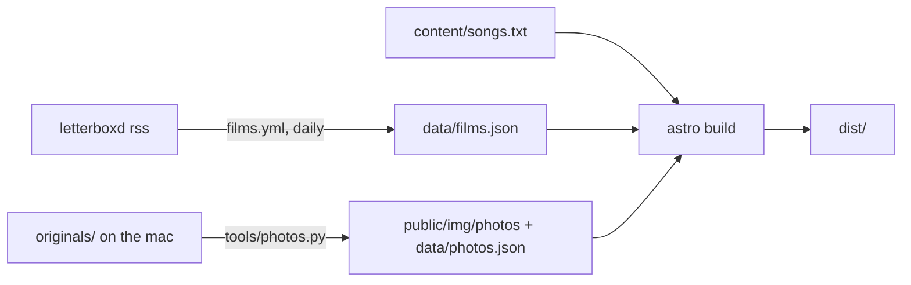

```
 ███╗   ██╗██╗ ██████╗██╗  ██╗████████╗██████╗ ██╗███╗   ███╗
 ████╗  ██║██║██╔════╝██║ ██╔╝╚══██╔══╝██╔══██╗██║████╗ ████║
 ██╔██╗ ██║██║██║     █████╔╝    ██║   ██████╔╝██║██╔████╔██║
 ██║╚██╗██║██║██║     ██╔═██╗    ██║   ██╔══██╗██║██║╚██╔╝██║
 ██║ ╚████║██║╚██████╗██║  ██╗   ██║   ██║  ██║██║██║ ╚═╝ ██║
 ╚═╝  ╚═══╝╚═╝ ╚═════╝╚═╝  ╚═╝   ╚═╝   ╚═╝  ╚═╝╚═╝╚═╝     ╚═╝
```

<div align="center">

### `NICKTRIM(1) // GENERAL COMMANDS MANUAL`

*a personal site that reads like `man nicktrim`, because it is one*

  -8a8a8a?style=flat-square&labelColor=111111)  

</div>

---

## 📖 What is this

The source of [nicktrim.com](https://nicktrim.com). The home page is a manual page: NAME, SYNOPSIS, DESCRIPTION, EXAMPLES, ENVIRONMENT, SEE ALSO, typed into a terminal and ending back at the prompt. Every subpage (about, work, cv, films, photos) is the same 80-character column with a link back to `nicktrim(1)` at the top.

Everything on it is data. The film diary comes from Letterboxd through a daily GitHub Action. The photos are real prints, resized and stripped of EXIF on this Mac before they are committed, so the originals never leave it. The song in ENVIRONMENT is picked at build time from a text file.

It replaced five earlier designs in five days. This one survived because it fits on one screen.

```console
nick@athens:~$ man nicktrim
NICKTRIM(1)              General Commands Manual              NICKTRIM(1)
[✓] rendered. no scroll.
[i] history section removed. it was in three other places.
```

## 📄 The pages

| | page | what it actually holds |
|---|---|---|
| 01 | **/** | the man page: synopsis, two paragraphs, four prints as polaroids, what is on repeat and last watched |
| 02 | **/about** | the long version as key-value rows: origin, how i work, ventures, off the keyboard, next |
| 03 | **/work** | 28 projects, one line each, with live and code links |
| 04 | **/cv** | the short cv as a table; ⌘P prints a paper version in black on white |
| 05 | **/films** | the Letterboxd diary, paged, reviews as written |
| 06 | **/photos** | 25 prints at their own aspect ratio, in the order they were picked, with a viewer |

## 🚀 Run it

Bun and, for the photo pipeline, uv.

```bash
git clone https://github.com/nitrimandylis/portfolio.git
cd portfolio
bun install
bun run dev
```

`bun run build` writes `dist/`. Vercel builds it from a push to main.

## 🔩 Under the hood



| layer/file | path | job |
|---|---|---|
| home | `src/pages/index.astro` | the man page, sized to end at the prompt on a 1440x900 screen |
| subpage frame | `src/layouts/ManSub.astro` | the back link, the bold title, the 7ch indent |
| skin | `src/styles/mono.css` | jetbrains mono, #000, #e6e6e6, one grey, print rules |
| copy and data | `src/data/site.ts`, `work.ts`, `films.ts` | every fact the site states, in one place |
| films | `tools/films.py` + `.github/workflows/films.yml` | appends new diary entries, stdlib only, commits them |
| work | `tools/work.py` + `.github/workflows/work.yml` | rewrites `data/repos.json` from public GitHub repos daily; `work.ts` lists the ones it does not already name |
| photos | `tools/photos.py` | webp at 1600 and 600, EXIF and GPS gone, order from `content/photos.txt` |
| handwriting | `tools/hand_from_rm.py` | cuts stroke SVGs out of a reMarkable page |
| drafts | `proto/` | the mockups the current design beat, kept for the record |

**Stack:** Astro · Bun · hand-written CSS · Python for the two pipelines · Vercel

---

<div align="center">

**[Nick Trimandylis](https://github.com/nitrimandylis)**

`OCCASIONALLY FINISHES THEM`

MIT licensed.

</div>
